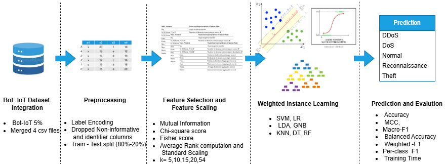

# IoT Intrusion Detection using Machine Learning

A machine learning-based intrusion detection project investigating the impact of feature dimensionality on identifying malicious IoT network traffic using statistical feature selection and supervised classification models on the BoT-IoT dataset.

---

## Project Highlights

- Analysed 3.6M+ IoT network traffic records.
- Evaluated 7 machine learning classifiers.
- Applied three statistical feature selection techniques.
- Investigated the relationship between feature subset size and model performance.
- Identified performance saturation with compact feature subsets.
- Research paper accepted at IEEE WiSPNET 2026.

---

## Tech Stack

### Programming Languages and Libraries
- Python
- Pandas
- NumPy
- Scikit-learn
- Matplotlib
- Seaborn

### Analytical Concepts
- Data Preprocessing
- Exploratory Data Analysis
- Feature Selection
- Machine Learning Classification
- Model Evaluation
- Imbalanced Data Analysis

---

## Machine Learning Models

1. Logistic Regression
2. Support Vector Machine (SVM)
3. k-Nearest Neighbors (KNN)
4. Decision Tree
5. Random Forest
6. Gaussian Naive Bayes
7. Linear Discriminant Analysis (LDA)

---

## Feature Selection Techniques

- Mutual Information
- Chi-Square Test
- Fisher Score

Feature subsets of different sizes (k = 5, 10, 15, 20 and 54) were evaluated to study the effect of dimensionality on classification performance.

---

## Evaluation Metrics

- Macro-F1 Score
- Balanced Accuracy
- Matthews Correlation Coefficient (MCC)

---

## Project Workflow

The following diagram illustrates the research workflow, from dataset preparation and feature selection to model training and performance evaluation.



---

## Key Findings

- Tree-based models demonstrated strong classification performance.
- Performance generally approached saturation with approximately 15–20 selected features.
- Increasing the number of features did not consistently improve classification performance.
- Compact feature subsets offered a way to reduce dimensionality while maintaining competitive model performance.
- Feature selection methods influenced the resulting model performance.

---

## Repository Contents

```text
iot-intrusion--detection-ml/
│
├── intrusion_detection_analysis.ipynb
├── presentation.pdf
├── pipelineee.png
└── README.md
```

---

## Dataset

**Dataset:** BoT-IoT Dataset  
**Source:** UNSW Canberra Cyber Range Lab

Dataset: https://research.unsw.edu.au/projects/bot-iot-dataset

---

## Research Publication

**Title:** Assessing the Impact of Feature Dimensionality on IoT Intrusion Detection

**Conference:** IEEE WiSPNET 2026

**Track:** Network Security, Privacy, and Quantum Communications

**Status:** Accepted
